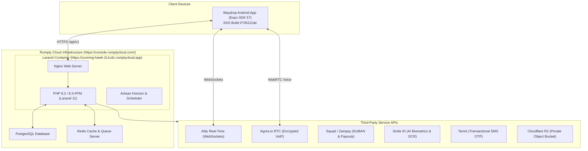

# Waydrop: Technical Deployment & User Guide

> **Live Backend API & Admin Desk:** [https://cunning-hawk-2c1cdc.rumptycloud.app/](https://cunning-hawk-2c1cdc.rumptycloud.app/)  
> **Rumpty Cloud Infrastructure Console:** [https://console.rumptycloud.com/](https://console.rumptycloud.com/)  
> **Android Mobile App Download (EAS Build):** [https://expo.dev/accounts/munir_ammani/projects/waydrop/builds/735211de-9f6c-4d18-b77e-df8dec66b789](https://expo.dev/accounts/munir_ammani/projects/waydrop/builds/735211de-9f6c-4d18-b77e-df8dec66b789)  
> **Platform Version:** 1.0.0 (Production Staging)  

---

## Table of Contents
1. [Quick Reference & Access Links](#1-quick-reference--access-links)
2. [System Architecture & Deployment Topology](#2-system-architecture--deployment-topology)
3. [Backend Deployment Guide (Rumpty Cloud)](#3-backend-deployment-guide-rumpty-cloud)
   - [3.1 Rumpty Cloud Service Overview](#31-rumpty-cloud-service-overview)
   - [3.2 Production Environment Variables](#32-production-environment-variables)
   - [3.3 Database Setup, Migrations & Seeders](#33-database-setup-migrations--seeders)
   - [3.4 Horizon Queue Workers & Scheduler](#34-horizon-queue-workers--scheduler)
   - [3.5 Verification & Health Checks](#35-verification--health-checks)
4. [Mobile App Build & Distribution Guide (Expo & EAS)](#4-mobile-app-build--distribution-guide-expo--eas)
   - [4.1 EAS Configuration (`eas.json`)](#41-eas-configuration-easjson)
   - [4.2 Building the Internal Distribution APK](#42-building-the-internal-distribution-apk)
   - [4.3 Installing the App on Android Devices](#43-installing-the-app-on-android-devices)
   - [4.4 Building for Google Play Store (Production AAB)](#44-building-for-google-play-store-production-aab)
5. [End-User Operating Guide](#5-end-user-operating-guide)
   - [5.1 Registration & Authentication](#51-registration--authentication)
   - [5.2 Using Request Mode (Senders)](#52-using-request-mode-senders)
   - [5.3 Using Earn Mode (Runners)](#53-using-earn-mode-runners)
   - [5.4 Handshake PIN & Proof-of-Delivery](#54-handshake-pin--proof-of-delivery)
   - [5.5 In-App VoIP Calling & Visual Beacon](#55-in-app-voip-calling--visual-beacon)
   - [5.6 Wallet Funding & Bank Withdrawals](#56-wallet-funding--bank-withdrawals)
6. [Administrator Operations Manual (Admin Desk)](#6-administrator-operations-manual-admin-desk)
   - [6.1 Accessing the Admin Desk](#61-accessing-the-admin-desk)
   - [6.2 Managing Daily Operations (Desks 01–03)](#62-managing-daily-operations-desks-0103)
   - [6.3 KYC & Identity Approvals (Desk 04)](#63-kyc--identity-approvals-desk-04)
   - [6.4 Unlocking Handshake PIN Failures (Desk 05)](#64-unlocking-handshake-pin-failures-desk-05)
   - [6.5 Crew Dispatch & Dynamic Rules (Desks 09 & 10)](#65-crew-dispatch--dynamic-rules-desks-09--10)
7. [Local Development & Testing](#7-local-development--testing)
8. [Troubleshooting & Maintenance Runbook](#8-troubleshooting--maintenance-runbook)

---

## 1. Quick Reference & Access Links

| Resource | URL / Details | Purpose |
| :--- | :--- | :--- |
| **Live Backend API** | `https://cunning-hawk-2c1cdc.rumptycloud.app/api/v1` | Production REST API consumed by the mobile client. |
| **Admin Operations Desk** | `https://cunning-hawk-2c1cdc.rumptycloud.app/login` | Operational control room for campus leads and admins. |
| **Rumpty Cloud Console** | `https://console.rumptycloud.com/` | Cloud hosting platform (containers, environment variables, logs). |
| **Mobile App (Android APK)** | [Expo EAS Build #735211de](https://expo.dev/accounts/munir_ammani/projects/waydrop/builds/735211de-9f6c-4d18-b77e-df8dec66b789) | Direct shareable download link for Android test devices. |
| **Super Admin Login** | `superadmin@waydrop.ng` / `password123` | National platform control, treasury, campus provisioning. |
| **Campus Admin Login** | `admin@waydrop.ng` / `password123` | Local campus desk lead (BUK / UNILAG operations). |
| **Master Test OTP** | `800080` | Master verification code to sign into any phone number. |
| **Test User Account** | `+2347082262502` (Munir Ammani) | Seeded campus runner and requester with funded test wallet. |

---

## 2. System Architecture & Deployment Topology



---

## 3. Backend Deployment Guide (Rumpty Cloud)

The Laravel backend is deployed on **Rumpty Cloud** (`https://console.rumptycloud.com/`), running as a containerized PHP 8.2+ service with PostgreSQL and Redis.

### 3.1 Rumpty Cloud Service Overview
* **Application URL**: `https://cunning-hawk-2c1cdc.rumptycloud.app`
* **Root Directory**: `backend/`
* **Entry Script**: `public/index.php`
* **Web Server**: Nginx with PHP-FPM

---

### 3.2 Production Environment Variables
Configure the following environment variables in the **Rumpty Cloud Console** under your project settings:

```env
# --- Application Basics ---
APP_NAME=Waydrop
APP_ENV=production
APP_KEY=base64:... (Generate via: php artisan key:generate --show)
APP_DEBUG=false
APP_URL=https://cunning-hawk-2c1cdc.rumptycloud.app

# --- Database (PostgreSQL / MySQL) ---
DB_CONNECTION=pgsql
DB_HOST=<rumpty-postgres-host>
DB_PORT=5432
DB_DATABASE=waydrop_prod
DB_USERNAME=<rumpty-db-user>
DB_PASSWORD=<rumpty-db-password>

# --- Cache, Session & Queues ---
CACHE_STORE=redis
SESSION_DRIVER=redis
QUEUE_CONNECTION=redis
REDIS_HOST=<rumpty-redis-host>
REDIS_PORT=6379
REDIS_PASSWORD=<rumpty-redis-password>

# --- Security & Rate Limiting ---
SANCTUM_EXPIRATION=525600
MASTER_OTP=800080

# --- SMS OTP (Termii) ---
TERMII_API_KEY=<your-termii-api-key>
TERMII_SENDER_ID=Waydrop
TERMII_BASE_URL=https://api.ng.termii.com

# --- Payments & Payouts (Squad / HabariPay) ---
SQUAD_SECRET_KEY=<your-squad-secret-key>
SQUAD_PUBLIC_KEY=<your-squad-public-key>
SQUAD_WEBHOOK_SECRET=<your-squad-webhook-secret>
SQUAD_BASE_URL=https://api-d.squadco.com
SQUAD_VERIFY_SSL=true

# --- Alternative Gateway (Zainpay) ---
ZAINPAY_PUBLIC_KEY=<your-zainpay-public-key>
ZAINPAY_SECRET_KEY=<your-zainpay-secret-key>
ZAINPAY_BASE_URL=https://api.zainpay.ng
ZAINPAY_VERIFY_SSL=true

# --- AI Identity & Biometrics (Smile ID) ---
SMILE_ID_PARTNER_ID=<your-smile-id-partner-id>
SMILE_ID_API_KEY=<your-smile-id-api-key>
SMILE_ID_SERVER=https://api.smileidentity.com/v1

# --- Real-Time WebSockets (Ably) ---
ABLY_API_KEY=<your-ably-api-key>

# --- In-App Voice Calling (Agora.io) ---
AGORA_APP_ID=<your-agora-app-id>
AGORA_APP_CERTIFICATE=<your-agora-app-certificate>

# --- Push Notifications (Expo) ---
EXPO_ACCESS_TOKEN=<your-expo-access-token>

# --- Storage (Cloudflare R2 / AWS S3) ---
FILESYSTEM_DISK=r2
AWS_ACCESS_KEY_ID=<your-r2-access-key-id>
AWS_SECRET_ACCESS_KEY=<your-r2-secret-access-key>
AWS_DEFAULT_REGION=auto
AWS_BUCKET=waydrop-media-prod
AWS_ENDPOINT=https://<account-id>.r2.cloudflarestorage.com
AWS_USE_PATH_STYLE_ENDPOINT=false
```

---

### 3.3 Database Setup, Migrations & Seeders
When deploying a new container revision or spinning up a fresh database on Rumpty Cloud, execute the deployment hooks:

```bash
# 1. Run pending database migrations
php artisan migrate --force

# 2. Seed campus reference data, default rules, and administrator accounts
php artisan db:seed --class=CampusDatabaseSeeder --force
php artisan db:seed --class=UserSeeder --force

# 3. (Optional for Staging/Demo) Seed Munir Ammani and mock campus data
php artisan db:seed --class=MunirAmmaniSeeder --force

# 4. Cache configuration and routes for production speed
php artisan config:cache
php artisan route:cache
php artisan view:cache
```

---

### 3.4 Horizon Queue Workers & Scheduler
Background workers handle real-time push alerts, SMS dispatch, webhook reconciliation, and automated biometric verification.

#### Background Worker Process:
In the Rumpty Cloud background services tab, configure the queue daemon:
```bash
php artisan queue:work redis --sleep=3 --tries=3 --timeout=90
```
*(Or use `php artisan horizon` if Laravel Horizon is enabled).*

#### Cron Schedule Configuration:
Set up a recurring 1-minute system cron job:
```bash
* * * * * cd /var/www/html && php artisan schedule:run >> /dev/null 2>&1
```

---

### 3.5 Verification & Health Checks
Run these smoke tests against the production backend to verify deployment integrity:

1. **API Endpoint Test**:
   ```bash
   curl -i https://cunning-hawk-2c1cdc.rumptycloud.app/api/v1/areas/nearby?lat=11.980560&lng=8.479440
   ```
   *Expected Response:* `200 OK` with JSON array containing Bayero University Kano (`buk-new`).

2. **Admin Desk Web Interface**:
   Open `https://cunning-hawk-2c1cdc.rumptycloud.app/login` in your browser. Verify the custom Waydrop Desk login screen loads with HTTPS.

3. **Ably Authentication Token**:
   ```bash
   curl -i https://cunning-hawk-2c1cdc.rumptycloud.app/api/v1/realtime/token
   ```
   *Expected Response:* `200 OK` with JSON containing Ably token request capability payload.

---

## 4. Mobile App Build & Distribution Guide (Expo & EAS)

The mobile client is built using **React Native** and **Expo SDK 57**, utilizing Expo Application Services (EAS) to compile native Android APKs and Google Play App Bundles (AAB).

### 4.1 EAS Configuration (`eas.json`)
Located at `waydrop/eas.json`:

```json
{
  "build": {
    "preview": {
      "distribution": "internal",
      "android": {
        "buildType": "apk"
      },
      "env": {
        "EXPO_PUBLIC_API_BASE_URL": "https://cunning-hawk-2c1cdc.rumptycloud.app/api/v1"
      }
    },
    "production": {
      "android": {
        "buildType": "app-bundle"
      },
      "env": {
        "EXPO_PUBLIC_API_BASE_URL": "https://cunning-hawk-2c1cdc.rumptycloud.app/api/v1"
      }
    }
  }
}
```

> [!IMPORTANT]
> The `EXPO_PUBLIC_API_BASE_URL` is compiled directly into the binary. It must always point to the production HTTPS URL:  
> `https://cunning-hawk-2c1cdc.rumptycloud.app/api/v1`

---

### 4.2 Building the Internal Distribution APK
To trigger a new shareable Android `.apk` build:

```powershell
# 1. Navigate to the mobile client directory
cd waydrop

# 2. Authenticate with EAS
npx eas-cli login

# 3. Validate project configuration
npm run typecheck
npx expo-doctor

# 4. Trigger the preview build
npx eas-cli build --platform android --profile preview
```

EAS executes the build in the cloud, generates the signing keystore automatically, and produces a permanent public download URL.

---

### 4.3 Installing the App on Android Devices
Testers and campus leads can install the latest release directly:

1. Open the download link on an Android device:  
   👉 **[https://expo.dev/accounts/munir_ammani/projects/waydrop/builds/735211de-9f6c-4d18-b77e-df8dec66b789](https://expo.dev/accounts/munir_ammani/projects/waydrop/builds/735211de-9f6c-4d18-b77e-df8dec66b789)**
2. Tap **"Install"** or download the `.apk` file directly.
3. If prompted by Android, enable **"Install unknown apps"** for your mobile browser.
4. Open the installed **Waydrop** app. Grant permissions for **Location**, **Notifications**, and **Microphone** (required for in-app voice calling).

---

### 4.4 Building for Google Play Store (Production AAB)
When preparing a store release for Google Play:

1. Increase `versionCode` in `waydrop/app.json`:
   ```json
   "android": {
     "package": "app.waydrop",
     "versionCode": 2
   }
   ```
2. Run the production build command:
   ```powershell
   npx eas-cli build --platform android --profile production
   ```
3. Download the resulting `.aab` file from the EAS dashboard and upload it to the **Google Play Console** under **Internal Testing** or **Production**.

---

## 5. End-User Operating Guide

### 5.1 Registration & Authentication
1. **Launch App**: Open Waydrop on your phone.
2. **Phone Number**: Enter your Nigerian mobile phone number (e.g. `0803 123 4567` or `+234 803 123 4567`).
3. **OTP Verification**:
   * **Live SMS**: An automated 6-digit SMS OTP is sent via Termii.
   * **Staging / Master Bypass**: If testing without telecom credit, enter the Master OTP: **`800080`**.
4. **Profile Setup**: Provide your first name, last name, and profile photo.
5. **Campus Detection**: The app reads your GPS position and connects to your university (e.g. Bayero University Kano). If outside campus bounds, select your campus from the search menu.
6. **Primary Mode**: Select **"Send Errands"** or **"Earn on My Walks"**.

---

### 5.2 Using Request Mode (Senders)
1. **Drafting an Errand**:
   * **Natural Language**: Type a single sentence into the search bar:  
     *"Bring my engineering calculator from Ramat Hall to Old Campus Library for ₦500"*.
   * The app highlights extracted locations, items, and suggested bounty.
2. **Review & Quote**:
   * Inspect the calculated route distance and walking duration.
   * Adjust bounty offer (minimum: ₦200).
   * Tap **"Lock Escrow & Find Runner"**. Funds are held securely in your wallet escrow.
3. **Live Matching Radar**:
   * The app broadcasts your errand to active runners nearby.
   * Tap **"+₦100"** or **"+₦200"** to boost your offer if urgent.
4. **Tracking the Runner**:
   * When accepted, view runner profile, rating, and real-time movement on campus.
   * Inspect the item photograph uploaded by the runner at pickup.
5. **Receiving Delivery**:
   * When the runner arrives, your app displays your secret **4-digit Delivery PIN**.
   * Inspect your physical item.
   * Read the PIN verbally to the runner to release payment.

---

### 5.3 Using Earn Mode (Runners)
1. **Complete Hybrid KYC (One-Time)**:
   * Tap **"Verify Student ID"** from the home drawer.
   * Enter Faculty, Department, and Matriculation Number.
   * Take a photo of your Student ID card.
   * Take a live selfie (turn head and blink to pass liveness).
   * Submit payout bank account (must match student ID name).
   * Upon admin approval, your status changes to **Verified Runner**.
2. **Setup Campus Walking Routines**:
   * Save your recurring walks (e.g. *"Hostel to Main Library at 8:00 AM"*).
   * The system reserves errands matching your route in advance.
3. **Accepting Gigs**:
   * An Errand Offer card pops up with a **25-second timer**.
   * Review pickup landmark, dropoff point, item type, and payout.
   * Swipe right to accept.
4. **Executing the Errand**:
   * Walk to pickup landmark and tap **"I've Arrived"**.
   * Snap a clear photo of the item (e.g. sealed food pack) and tap **"Confirm Pickup"**.
   * Walk to dropoff landmark and tap **"Arrived at Dropoff"**.
5. **Collecting Payment**:
   * Ask the recipient for their 4-digit Handshake PIN.
   * Enter the PIN on your numeric keypad.
   * Escrow unlocks instantly. Net earnings (`bounty - 10% fee`) are added to your available balance.

---

### 5.4 Handshake PIN & Proof-of-Delivery
* **Zero-Trust Rule**: The runner's app never receives the PIN in the network response. The recipient's app only displays the PIN when the runner is physically close.
* **Brute-Force Safeguard**: Entering 3 incorrect PINs locks the errand into `disputed` status to prevent guessing. The runner must contact the Campus Desk to resolve.

---

### 5.5 In-App VoIP Calling & Visual Beacon
* **Agora VoIP Calling**: Tap the phone icon on any active errand screen. A masked WebRTC voice call initiates through Agora.io. No telecom airtime is used, and personal phone numbers remain hidden.
* **Visual Beacon**: In crowded locations (cafeterias, hostel gates at night), tap **"Turn On Beacon"**. Your screen pulses with high-contrast neon strobe colors, and the phone flashlight blinks so the other party spots you immediately.

---

### 5.6 Wallet Funding & Bank Withdrawals
* **To Fund Wallet**: Tap **Wallet $\to$ Add Funds**. Transfer money to your assigned dedicated Squad NUBAN virtual account, or pay via Card/USSD. Balance reflects in under 10 seconds.
* **To Withdraw Earnings**: Tap **Wallet $\to$ Withdraw**. Enter withdrawal amount and select your saved bank (OPay, PalmPay, GTBank, Kuda, Access). Funds transfer instantly via interbank settlement.

---

## 6. Administrator Operations Manual (Admin Desk)

The Admin Desk provides real-time oversight for campus lead administrators and platform operators.

### 6.1 Accessing the Admin Desk
1. Open the web browser and visit:  
   👉 **[https://cunning-hawk-2c1cdc.rumptycloud.app/login](https://cunning-hawk-2c1cdc.rumptycloud.app/login)**
2. Sign in using administrative credentials:
   * **Super Admin**: `superadmin@waydrop.ng` | `password123`
   * **Campus Admin**: `admin@waydrop.ng` | `password123`
3. Upon authentication, you are redirected to **Desk 01 (Today & Campus Pulse)**.

---

### 6.2 Managing Daily Operations (Desks 01–03)
* **Desk 01 (Campus Pulse)**: Monitor median match time, percentage of unfulfilled errands, active campus runners, and live moving radar dots.
* **Desk 02 (Action Queue)**: Tickets requiring administrative action sorted by remaining SLA. Items with under 10 minutes turn red.
* **Desk 03 (Dispute Resolution Desk)**:
  1. Inspect side-by-side evidence: Pickup photo vs Dropoff damage photo.
  2. Read in-app chat transcript and call logs.
  3. Initiate a 3-way masked phone call with requester and runner.
  4. Select resolution:
     * *Full refund, Waydrop covers runner (Goodwill)*.
     * *Full refund, runner not paid (Runner fault)*.
     * *No refund, release escrow to runner*.

---

### 6.3 KYC & Identity Approvals (Desk 04)
1. Navigate to `/desk/kyc`.
2. Inspect student ID card photo against the live liveness selfie.
3. Review AI match confidence (e.g. `94%`) and NUBAN bank account name match.
4. Click **"Approve Runner"** (runner is immediately activated), **"Ask to Redo Step"**, or **"Reject"**.

---

### 6.4 Unlocking Handshake PIN Failures (Desk 05)
When a runner enters 3–5 wrong PINs:
1. Navigate to `/desk/locked-handovers`.
2. Review the submitted PINs (often digits are transposed, e.g. `9042` instead of `4029`).
3. Tap **"Call Both"** to verbally verify that the item is physically in the requester's hands.
4. Tap **"Confirm Handover by Phone"** to release escrow funds to the runner.

---

### 6.5 Crew Dispatch & Dynamic Rules (Desks 09 & 10)
* **Desk 09 (Crew & Routines)**: Toggle the **90-Second Crew Safety Net**. When enabled, errands unmatched after 90 seconds are automatically escalated to hourly standby student crew members.
* **Desk 10 (Rules Configuration - Super Admin)**: Modify commission rate (default: `10%`), minimum bounty (default: `₦200`), runner swipe timer (default: `25s`), or maximum cash fronting cap (default: `₦3,000`). All changes take effect immediately without app updates.

---

## 7. Local Development & Testing

### Running the Backend Locally
```bash
cd backend
composer install
cp .env.example .env
php artisan key:generate
php artisan migrate --seed
php artisan serve
```
Backend runs locally at: `http://127.0.0.1:8000`

### Running the Mobile Client Locally
```bash
cd waydrop
npm install

# Point mobile client to local backend or production backend:
# (Set EXPO_PUBLIC_API_BASE_URL="http://192.168.x.x:8000/api/v1" in .env.local)

npx expo start
```
* Press `a` to run on connected Android device/emulator.
* Note: Agora voice calling requires a compiled native build (`npm run android` or the EAS APK).

---

## 8. Troubleshooting & Maintenance Runbook

| Symptom | Root Cause | Solution |
| :--- | :--- | :--- |
| **Mobile app shows "Network Error"** | Backend container stopped or `EXPO_PUBLIC_API_BASE_URL` wrong | Verify `https://cunning-hawk-2c1cdc.rumptycloud.app/api/v1/areas/nearby` in browser. Re-deploy container in Rumpty Console if down. |
| **OTP SMS not arriving on phone** | Nigerian DND active or Termii balance zero | Use Master OTP **`800080`** for immediate access. Verify Termii wallet balance in Termii dashboard. |
| **VoIP audio call does not connect** | Missing microphone permission or Agora token error | Ensure user granted microphone access in Android app settings. Verify `AGORA_APP_ID` and `AGORA_APP_CERTIFICATE` in Rumpty Cloud `.env`. |
| **PIN fails with "TASK_DISPUTED"** | 3 incorrect attempts entered | Open Admin Desk at `/desk/locked-handovers`, call both parties, and click *"Confirm Handover by Phone"*. |
| **Runner payout shows "Failed"** | Destination commercial bank network timeout | Visit `/desk/payouts` on Admin Desk and click *"Retry Payout"*. |
| **"Cannot connect to Ably WebSocket"** | Expired or invalid Ably key | Check `ABLY_API_KEY` in backend environment variables. |
