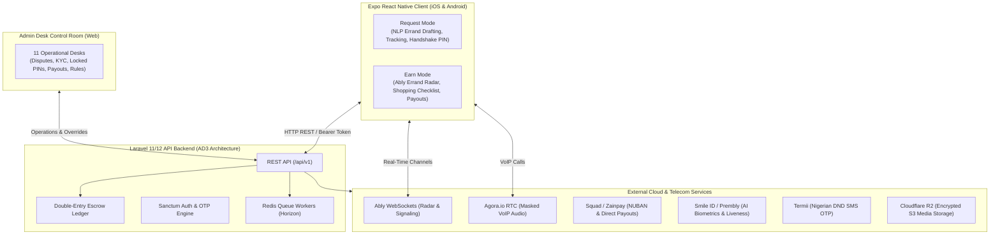
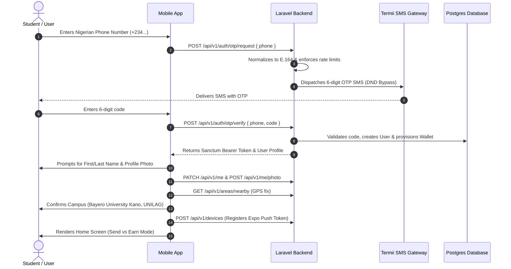
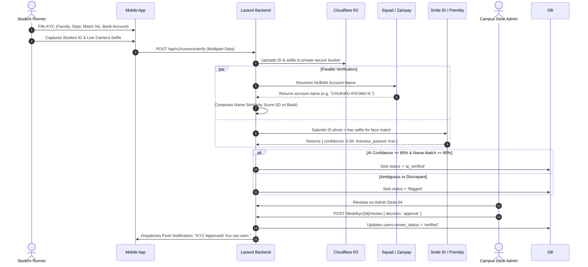
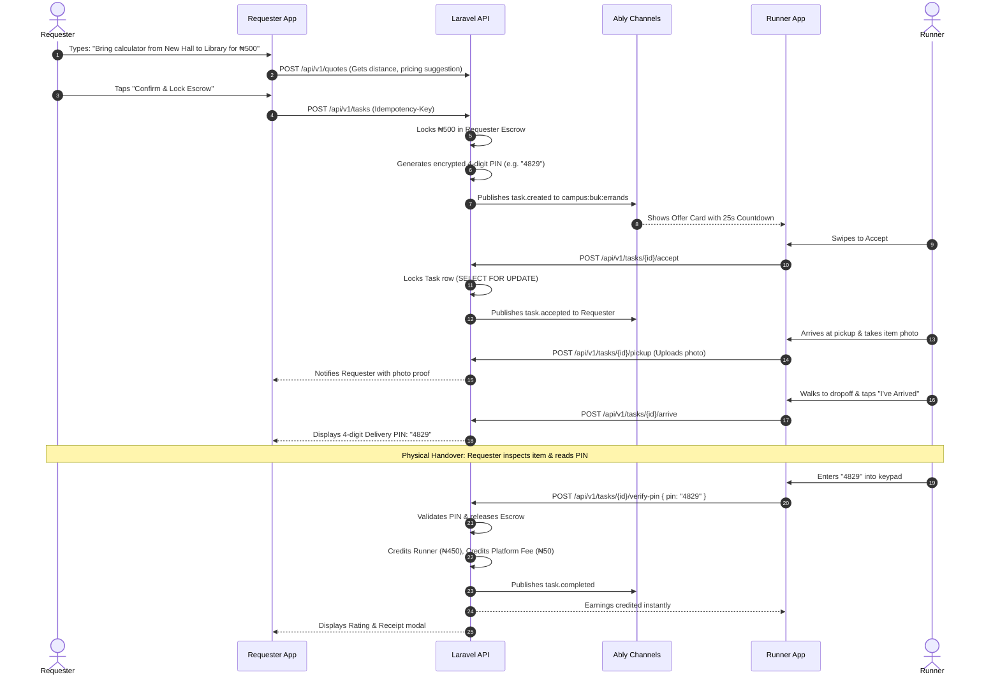
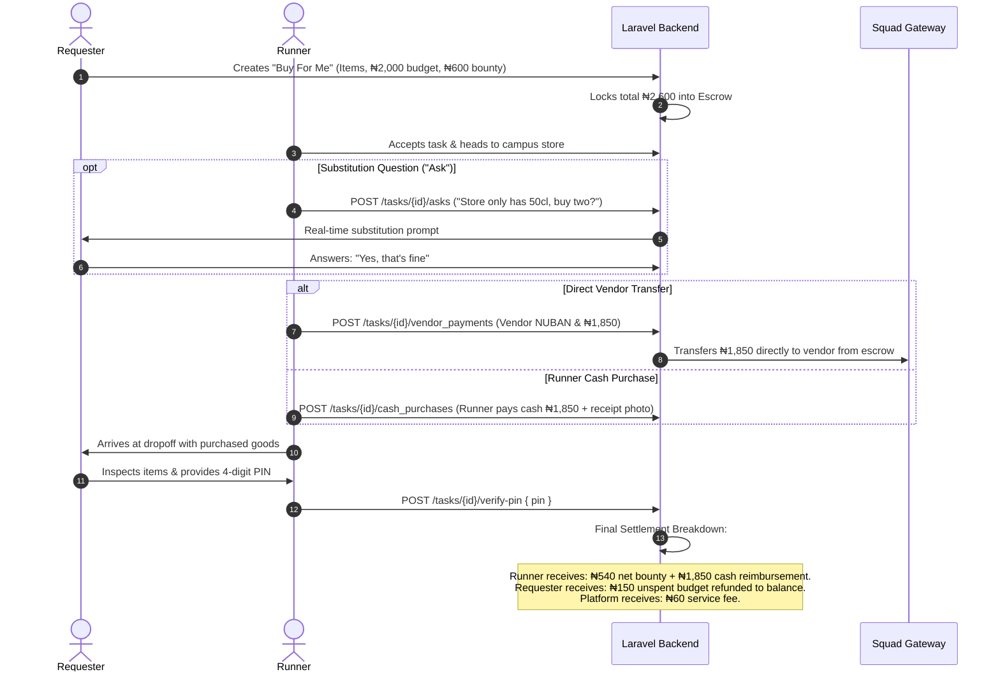
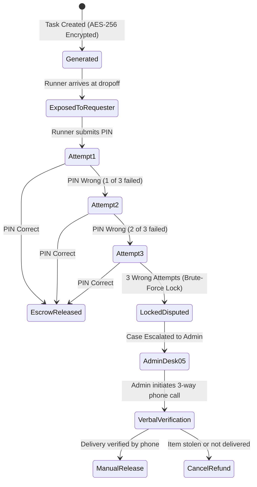
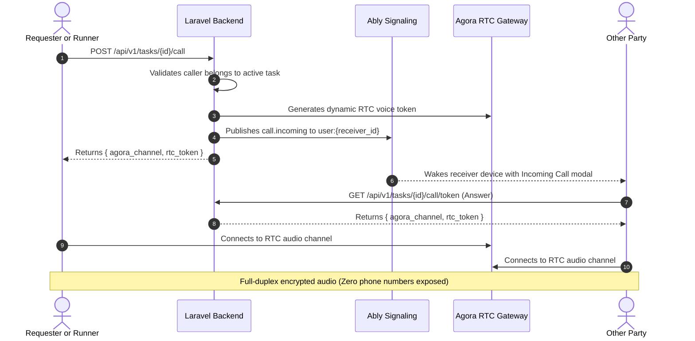
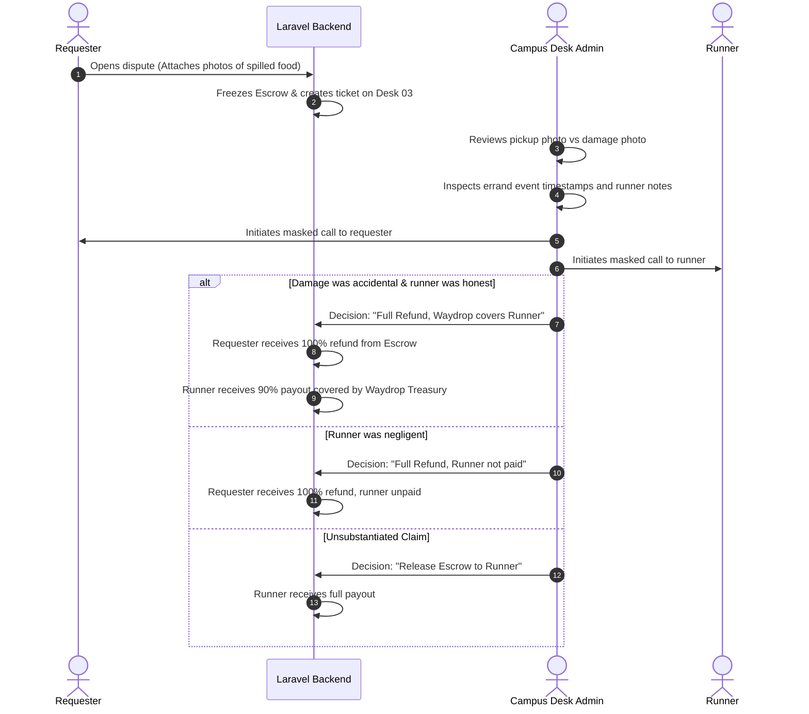
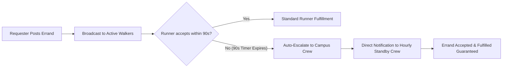

# Waydrop: Full System Description & Architecture Specification

> **Platform:** Waydrop — Peer-to-Peer Campus Errand & Micro-Logistics Platform  
> **Initial Deployments:** Nigerian Universities (Bayero University Kano, University of Lagos)  
> **Core Slogan:** *"Errands that ride along your way"*  
> **Date:** October 2026  

---

## Table of Contents
1. [Executive Summary & Concept](#1-executive-summary--concept)
2. [Technology Stack & System Architecture](#2-technology-stack--system-architecture)
3. [User Roles & Functional Responsibilities](#3-user-roles--functional-responsibilities)
   - [3.1 The Requester (Sender)](#31-the-requester-sender)
   - [3.2 The Runner (Courier / Mover)](#32-the-runner-courier--mover)
   - [3.3 The Administrator (Admin Desk & Super Admin)](#33-the-administrator-admin-desk--super-admin)
4. [The 11 Admin Operational Desks](#4-the-11-admin-operational-desks)
5. [End-to-End System Flows](#5-end-to-end-system-flows)
   - [Flow 1: User Onboarding & Authentication](#flow-1-user-onboarding--authentication)
   - [Flow 2: Runner Hybrid KYC Verification](#flow-2-runner-hybrid-kyc-verification)
   - [Flow 3: Standard Errand Lifecycle (P2P Handover)](#flow-3-standard-errand-lifecycle-p2p-handover)
   - [Flow 4: "Buy For Me" Errand Flow (Shopping & Cash Fronting)](#flow-4-buy-for-me-errand-flow-shopping--cash-fronting)
   - [Flow 5: Handshake PIN & Zero-Trust Delivery Policy](#flow-5-handshake-pin--zero-trust-delivery-policy)
   - [Flow 6: In-App Masked Voice Calling (Agora VoIP)](#flow-6-in-app-masked-voice-calling-agora-voip)
   - [Flow 7: Visual Screen Beacon (Crowd & Night Finding)](#flow-7-visual-screen-beacon-crowd--night-finding)
   - [Flow 8: Escrow Accounting & Double-Entry Ledger](#flow-8-escrow-accounting--double-entry-ledger)
   - [Flow 9: Dispute Resolution & Adjudication](#flow-9-dispute-resolution--adjudication)
   - [Flow 10: Campus Safety Net & Crew Dispatch](#flow-10-campus-safety-net--crew-dispatch)
   - [Flow 11: Instant Wallet Funding & Bank Withdrawals](#flow-11-instant-wallet-funding--bank-withdrawals)
6. [Role vs. Permission Matrix](#6-role-vs-permission-matrix)
7. [Error Catalog & Security Measures](#7-error-catalog--security-measures)

---

## 1. Executive Summary & Concept

**Waydrop** is a hyper-local peer-to-peer campus errand and micro-logistics platform designed specifically for high-density Nigerian university environments. 

In traditional logistics, couriers travel dedicated round-trips via motorbikes or cars, making micro-deliveries economically unfeasible for everyday campus needs (such as transporting a forgotten lecture notebook or a pack of cafeteria food for ₦300–₦500).

Waydrop replaces dedicated fleets with **social crowd-shipping**:
* **Every student is a potential courier**: Tens of thousands of students walk across campus daily between hostels, faculties, lecture theatres, cafeterias, and campus gates.
* **Zero vehicle emissions / zero fleet overhead**: Errands are carried on foot along routes students are already walking.
* **Dual-mode interface**: Every user has one account with an instant switch between **Request Mode** (posting errands) and **Earn Mode** (accepting gigs).

---

## 2. Technology Stack & System Architecture

### Tech Stack Details:
* **Mobile Frontend**: React Native `0.86`, Expo SDK `57` (New Architecture), Expo Router (file-based navigation), React Native Reanimated, Zustand state management.
* **Backend Framework**: Laravel 11/12 (PHP 8.2+) implementing Action-Domain-Driven Design (AD3).
* **Database & Persistence**: PostgreSQL with UUID primary keys and decimal coordinate fields; Redis for locks, queues, and caching.
* **Real-Time WebSockets**: Ably Channels (errand broadcasting, live runner telemetry, and call signaling).
* **Voice Communication**: Agora RTC Engine (encrypted WebRTC voice without exposing phone numbers).
* **Identity Verification**: Smile ID / Prembly Identitypass (AI 1:1 facial biometric matching and anti-spoofing liveness).
* **Payment Gateway**: Squad (HabariPay / GTCO) and Zainpay for Nigerian card/USSD deposits, automated dedicated NUBAN virtual accounts, and instant interbank payouts.
* **Transactional SMS**: Termii transactional route with DND (Do Not Disturb) bypass.
* **Object Storage**: Cloudflare R2 (S3-compatible, private bucket with zero egress fees).

---

## 3. User Roles & Functional Responsibilities

### 3.1 The Requester (Sender)
The Requester is any student or campus community member who needs an item moved or purchased.

#### Key Capabilities & Features:
1. **Natural Language Errand Composer**: Senders can compose an errand in natural conversational language (e.g., *"Bring my charger from Ramat Hall to Faculty of Law for 600"*). The parser (`src/lib/parseErrand.ts`) extracts:
   * Item name (`"my charger"`).
   * Origin location (`"Ramat Hall"`).
   * Destination location (`"Faculty of Law"`).
   * Bounty offer (`₦600`).
2. **Two Primary Errand Categories**:
   * **P2P Movement**: Moving forgotten items, study materials, lecture notes, lab coats, laundry, parcels, or cafeteria food.
   * **Buy For Me**: Requesting a runner to buy groceries, snacks, or stationery from campus kiosks and cafeterias. Requesters can specify item quantities, estimated prices, and fronting limits.
3. **Automated Route Pricing & Quotes**: Calculates route walking distance, estimated duration, and suggests competitive minimum/maximum bounty amounts based on campus terrain.
4. **Escrow Funding Guarantee**: When an errand is created, the bounty amount (plus shopping budget if "Buy For Me") is locked into escrow. Funds are never transferred until delivery is verified.
5. **Radar & Bounty Boosting**: Requesters can watch active runners on the campus radar. If urgent, they can boost the bounty (+₦100, +₦200) to incentivize faster pickups.
6. **Live Multi-Step Tracking**: Full visibility through delivery stages:
   * `s1_accepted` $\to$ Runner matched.
   * `s2_to_pickup` $\to$ Runner walking to pickup.
   * `s3_at_pickup` $\to$ Runner at pickup point.
   * `s4_photo_proof` $\to$ Runner uploads item photo.
   * `s6_en_route` $\to$ Runner walking to dropoff.
   * `s7_arrived` $\to$ Runner arrived at dropoff.
   * `s10_delivered` $\to$ PIN handshake complete.
7. **In-App VoIP & Chat**: Masked full-duplex voice calling (Agora) and instant chat messaging without exposing phone numbers.
8. **Visual Screen Beacon**: Triggers pulsating neon color screens or camera torch strobes to locate the runner in packed lecture theatres or gates at night.
9. **Handshake Delivery Verification**: Holds the private 4-digit PIN. Only shares it verbally after inspecting the physical item.
10. **Rating & Disputes**: Rates the runner (1–5 stars) or opens a formal dispute with photographic evidence.

---

### 3.2 The Runner (Courier / Mover)
The Runner is a verified student walking across campus who fulfills errands along their route to earn income.

#### Key Capabilities & Features:
1. **Hybrid Student KYC Verification**:
   * Submits student records (faculty, department, matriculation number).
   * Uploads official student ID card or portal course registration form.
   * Performs an AI biometric selfie liveness check (head turn and blink).
   * Submits payout bank NUBAN, automatically cross-referenced with their student ID name.
2. **Campus Walking Routines**: Allows runners to save their recurring walk schedules (e.g., *"Moremi to Faculty of Science, 7:40–8:10 AM"*) to receive advance notifications for matching errands.
3. **Earn Mode Radar**: Displays real-time campus errand opportunities on an interactive campus map.
4. **25-Second Errand Offer Bidding**: When a matching errand appears, the runner receives a dedicated swipe-to-accept card with a 25-second countdown timer.
5. **Proof-of-Pickup Enforcement**: Mandatory camera upload of the item/package at the pickup spot before the trip can progress to dropoff.
6. **"Buy For Me" Execution**:
   * Interactive checklist to mark items as found or unavailable.
   * In-store substitution "Asks" (e.g. asking the requester whether to substitute out-of-stock items).
   * Choice between direct vendor bank transfer or runner cash fronting.
   * Mandatory receipt photographic upload.
7. **Handshake PIN Submission**: Prompts the recipient for their 4-digit PIN upon handover, enters it into the keypad, and instantly unlocks their earnings.
8. **Instant Bank Withdrawals**: One-click transfer of earnings to any Nigerian commercial bank or fintech (OPay, PalmPay, Kuda, GTBank) via NUBAN transfers.

---

### 3.3 The Administrator (Admin Desk & Super Admin)
The administration tier is partitioned into **Campus Lead Administrators** and **Super Administrators**.

#### Role Distinction:
* **Campus Lead Administrator**: Assigned to a specific university campus (e.g., Bayero University Kano or University of Lagos). Manages daily campus incidents, verifies local student KYCs, monitors matching times, handles disputes, and manages local campus crew shifts.
* **Super Administrator**: Holds national platform authority across all campuses. Manages global platform rules (fees, caps, timers), creates new campuses, provisions campus admin credentials, reviews cross-campus audits, and withdraws accrued company commissions from the central treasury wallet.

---

## 4. The 11 Admin Operational Desks

The custom Admin Desk portal provides 11 specialized operational control centers:

### Desk 01: Today & Campus Pulse
* **Real-Time KPIs**: Live median match time (goal: $<4\text{ min}$), percentage of unmatched errands (goal: $<5\%$), count of active runners on campus routes, open errands count, and total escrow held in kobo.
* **Live Campus Radar Map**: Dynamic SVG canvas showing real-time student runner dots, active campus crew, and waiting errand hot spots.
* **"Needs You Now" Feed**: High-priority alert queue aggregating items from disputes, failed handovers, pending KYCs, and payout timeouts.
* **Platform Revenue (Super Admin)**: Displays platform treasury wallet balance, aggregate commission earned, and payout logs.

### Desk 02: Queue (Needs You Now)
* **SLA Priority Queue**: Aggregates all actionable campus tickets sorted by SLA countdown. Tickets turn red when fewer than 10 minutes remain.
* **Category Filters**: Instant filtering by *Disputes*, *ID Checks*, *Locked Handovers*, and *Failed Payouts*.

### Desk 03: Disputes Resolution Desk
* **Side-by-Side Photographic Evidence**: Compares pickup photo uploaded by the runner against the damage/spill photo submitted by the requester.
* **Errand Event Log**: Chronological timeline of every event (time accepted, arrival at pickup, photo timestamp, arrival at dropoff, PIN entry timestamp).
* **Communication History**: Access to in-errand chat transcripts and masked call logs.
* **3-Way Masked Calling**: Admin can initiate an instant masked telephone call with requester and runner.
* **4-Way Ledger Resolution Engine**:
  1. *Full refund to requester, Waydrop covers runner (Goodwill)*: Used when goods were damaged accidentally in transit and runner acted in good faith.
  2. *Full refund to requester, runner not paid*: Used when runner was negligent or at fault.
  3. *Partial refund*: Split allocation when part of an order arrived intact.
  4. *No refund, release escrow to runner*: Used when requester's claim is unsupported by evidence.

### Desk 04: KYC & ID Verification Desk
* **Side-by-Side Identity Comparison**: Displays uploaded Student ID card next to the live liveness-verified selfie.
* **AI Scoring**: Shows facial confidence score (0.00 to 1.00) and liveness status.
* **NUBAN Name Match**: Displays percentage similarity score between extracted student ID name and the registered bank account name.
* **Actions**: 1-click **Approve Runner**, **Ask to Redo Step** (e.g. blurry ID photo, dark selfie), or **Reject Runner** with structured feedback.

### Desk 05: Locked Handovers Desk
* **Anti-Brute-Force Resolution**: Displays errands locked due to 3–5 consecutive invalid PIN attempts.
* **Digit Order Analysis**: Inspects submitted codes to detect common transpositions (e.g. digits read backwards over phone).
* **Resolution**: Admin calls both parties to verify physical handover, then triggers **Confirm Handover by Phone** (releases escrow) or **Issue Fresh PIN**.

### Desk 06: People & Safety Desk
* **User Profile & Trust Metrics**: Displays user's total trips, rating, dispute history, and wallet balances.
* **Safety Report Investigations**: Manages reports of off-app cash solicitation, harassment, or unsafe behavior.
* **Enforcement Actions**: **Pause Runner** (blocks accepting gigs while permitting sending) or **Block Account** (freezes wallet and blocks login).

### Desk 07: Payouts & Banking Desk
* **Failed Withdrawal Monitoring**: Identifies interbank transfer timeouts from Nigerian commercial banks and fintechs.
* **Partner vs. Ledger Reconciliation**: Ensures payment gateway balances match internal ledger records.
* **Remediation**: 1-click **Retry Payout** or **Request Alternative Bank Details** from the runner.

### Desk 08: Places & Campus Landmarks Desk
* **Crowdsourced Campus Places**: Reviews student-suggested pickup/dropoff points and campus slang (e.g., *"Back gate of Jaja Hall"*).
* **Student Bounty Reward**: Approving a user-submitted campus landmark automatically credits ₦50 to the student's wallet.
* **Curation**: Rename, edit GPS coordinates, or merge duplicate places.

### Desk 09: Crew & Routines Desk
* **Hourly Standby Crew Management**: Manages dedicated hourly-paid student crew members stationed across campus.
* **90-Second Safety Net Switch**: When enabled, any errand that remains unmatched for 90 seconds is automatically dispatched to an active crew member, guaranteeing zero dropped errands.
* **Routine Demand Pre-Matching**: Analyzes tomorrow morning's popular walking routes vs. scheduled runner routines to identify coverage gaps in advance.

### Desk 10: Rules Configuration Desk (Super Admin)
* **Live System Tuning**: Modifies system parameters without app redeployments:
  * `fee_rate`: Platform commission (default: 10%).
  * `min_offer`: Minimum permitted errand bounty (default: ₦100 / ₦200).
  * `offer_ttl`: Runner offer swipe timer (default: 25 seconds).
  * `crew_after`: Spillover timer before errand escalates to Crew (default: 90 seconds).
  * `pin_attempts`: Failed PIN attempts before handover locks (default: 3–5).
  * `cash_cap`: Maximum cash a runner can front for shopping (default: ₦3,000).

### Desk 11: Audit Log Desk
* **Tamper-Evident Historical Record**: Immutable log of every administrative decision, rule adjustment, manual escrow release, and automated security event. Includes staff name, IP, target ID, and mandatory stated justification.

---

## 5. End-to-End System Flows

### Flow 1: User Onboarding & Authentication

---

### Flow 2: Runner Hybrid KYC Verification

---

### Flow 3: Standard Errand Lifecycle (P2P Handover)

---

### Flow 4: "Buy For Me" Errand Flow (Shopping & Cash Fronting)

---

### Flow 5: Handshake PIN & Zero-Trust Delivery Policy

* **Security Guarantees**:
  * The PIN is completely stripped from all API responses delivered to the runner (`TaskResource`).
  * Possession of the physical item is traded directly for the verbal PIN code.
  * After 3 failed attempts, the task locks automatically into `disputed` status, freezing escrow and alerting **Admin Desk 05**.

---

### Flow 6: In-App Masked Voice Calling (Agora VoIP)

---

### Flow 7: Visual Screen Beacon (Crowd & Night Finding)
To solve the common challenge of finding someone at a crowded campus landmark (e.g. university gate, stadium, food court):
1. Either user taps the **Visual Beacon** button on the tracking screen.
2. The user's phone screen pulses with high-contrast neon strobe colors (white, tangerine, cyan) and triggers the camera torch.
3. The other party receives an in-app notice: *"Look for the flashing screen near the entrance."*

---

### Flow 8: Escrow Accounting & Double-Entry Ledger

Every kobo in the platform is tracked across two primary wallet columns: `balance_kobo` (available funds) and `escrow_kobo` (funds held for active tasks).

| Stage | Requester Wallet | Runner Wallet | Waydrop Treasury | Ledger Record (`transactions`) |
| :--- | :--- | :--- | :--- | :--- |
| **1. Errand Posted (₦500 bounty)** | Balance: $-\text{₦}500$ Escrow: $+\text{₦}500$ | Unchanged | Unchanged | `escrow_lock` (50,000 kobo) |
| **2. Errand Completed** | Escrow: $-\text{₦}500$ | Balance: $+\text{₦}450$ | Balance: $+\text{₦}50$ | `escrow_release` (45,000 kobo) `platform_fee` (5,000 kobo) |
| **3. Alternative: Cancelled** | Escrow: $-\text{₦}500$ Balance: $+\text{₦}500$ | Unchanged | Unchanged | `escrow_refund` (50,000 kobo) |

$$\text{Wallet Available Balance} + \text{Escrow Balance} = \sum(\text{Credits}) - \sum(\text{Debits})$$

---

### Flow 9: Dispute Resolution & Adjudication

---

### Flow 10: Campus Safety Net & Crew Dispatch

* Scheduled and monitored through **Admin Desk 09**.
* Guarantees that errands during off-peak hours or in quieter campus areas are never abandoned, keeping the unmatched rate below 5%.

---

### Flow 11: Instant Wallet Funding & Bank Withdrawals
1. **Wallet Deposit**:
   * Requester taps *"Add Money"* in the mobile app.
   * Squad generates a dedicated Virtual Account Number (NUBAN) or opens card/USSD checkout.
   * Upon bank transfer arrival, Squad triggers the webhook (`POST /api/v1/webhooks/squad`).
   * Laravel verifies the HMAC SHA-512 signature, credits `wallets.balance_kobo`, and creates a `deposit` transaction record.
2. **Bank Payout (Withdrawal)**:
   * Runner requests withdrawal of available balance.
   * Laravel debits `balance_kobo` and dispatches a transfer job to the Squad Transfers API.
   * Funds arrive in the runner's Nigerian bank or fintech account (OPay, PalmPay, Kuda, GTBank) in under 60 seconds.
   * If a commercial bank times out, **Admin Desk 07** flags the transaction for 1-click retry.

---

## 6. Role vs. Permission Matrix

| Capability | Requester | Runner | Campus Admin | Super Admin |
| :--- | :---: | :---: | :---: | :---: |
| Post errands via Natural Language | Yes | Yes | — | — |
| Lock & hold funds in Escrow | Yes | — | — | — |
| View delivery Handshake PIN | Yes | Stripped | Audit Only | Audit Only |
| Accept errands along walking routes | — | Verified Only | — | — |
| Enter delivery PIN to unlock payout | — | Yes | — | — |
| In-App masked Agora VoIP calling | Yes | Yes | Via Desk | Via Desk |
| Withdraw earnings to Nigerian bank | Yes | Yes | — | Revenue Only |
| Review & approve Student KYC | — | — | Yes | Yes |
| Adjudicate disputes & reverse ledger | — | — | Yes | Yes |
| Unlock brute-forced Handshake PINs | — | — | Yes | Yes |
| Dispatch standby campus Crew | — | — | Yes | Yes |
| Adjust platform rules & fee percentages | — | — | — | Yes |
| Add campuses & assign Campus Admins | — | — | — | Yes |

---

## 7. Error Catalog & Security Measures

### Standard API Error Codes:
* `INVALID_INPUT` (`400`): Malformed phone number or payload validation failure.
* `UNAUTHENTICATED` (`401`): Missing or expired Sanctum Bearer token.
* `INSUFFICIENT_FUNDS` (`402`): Wallet balance is less than required task bounty or raise amount.
* `UNAUTHORIZED_RUNNER` (`403`): User attempted to accept an errand without verified runner status.
* `NOT_FOUND` (`404`): Task, area, or user does not exist.
* `ALREADY_ACCEPTED` (`409`): Errand was already claimed by another runner.
* `CODE_EXPIRED` (`410`): SMS OTP code exceeded its 5-minute lifespan.
* `INVALID_PIN` (`422`): Incorrect 4-digit Handshake PIN entered.
* `TASK_DISPUTED` (`423`): Task locked due to 3 consecutive wrong PIN attempts.
* `TOO_MANY_REQUESTS` (`429`): Rate limits exceeded on OTP requests or task creation.

### Platform Security Mechanisms:
1. **Idempotency Protection (`Idempotency-Key`)**: Mutating endpoints (`POST /tasks`, `POST /verify-pin`, `POST /wallet/withdraw`) enforce idempotency keys stored in Redis to prevent double debits during unstable campus cellular reception.
2. **Sanitized Nigerian E.164 Formatting**: All phone inputs are normalized to `+234...` before processing.
3. **SMS OTP Abuse Mitigation**: Restricted to a maximum of 3 OTP requests per phone number per hour, and 5 per IP address per hour.
4. **Webhook HMAC Signatures**: All incoming payment webhooks from Squad or Zainpay verify HMAC SHA-512 signatures before processing.
