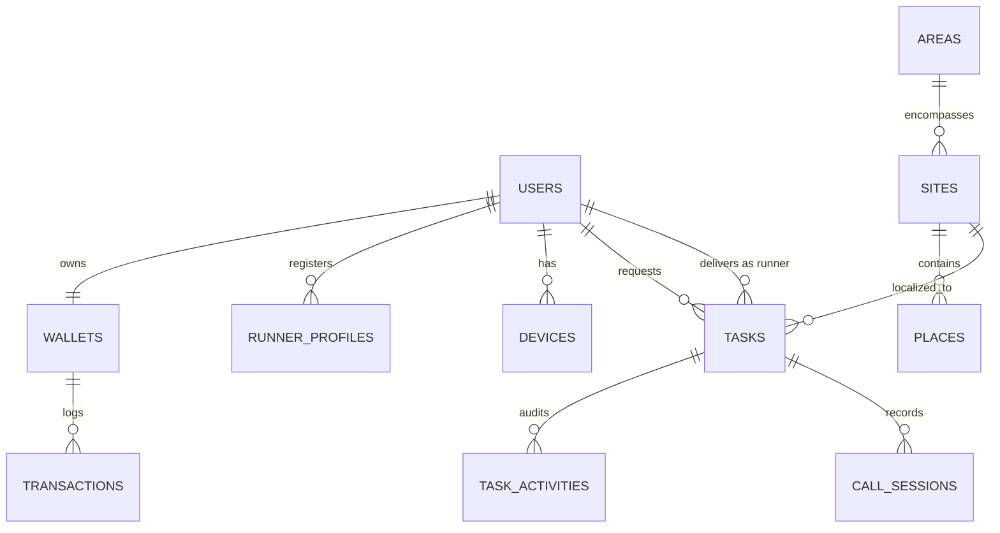
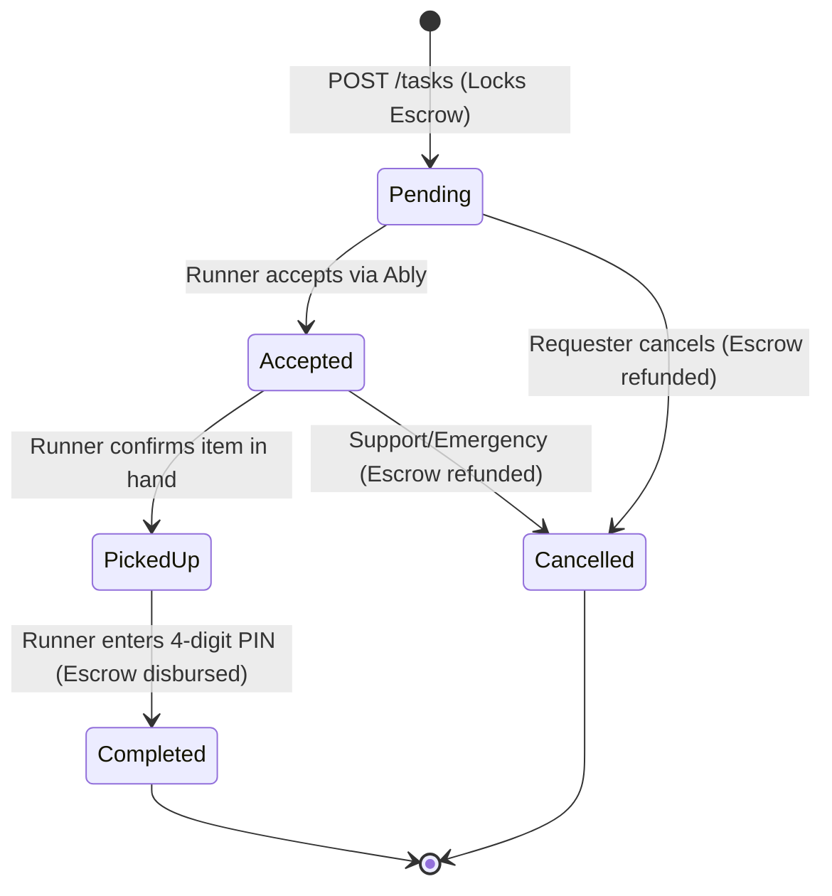
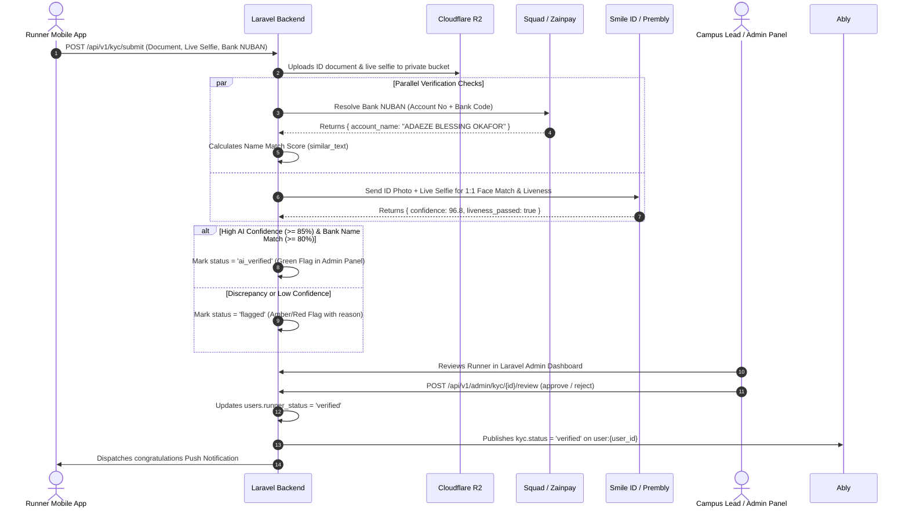
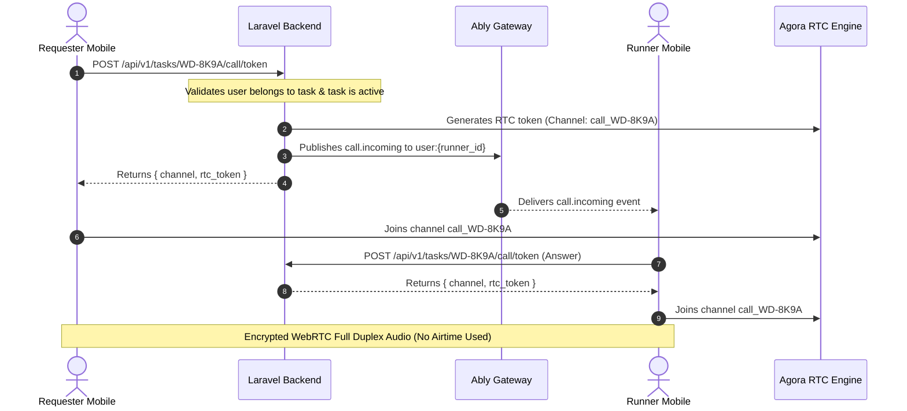

# Waydrop Backend: Complete System Structure & Technical Specification

> **Document Type:** Master Technical Design Document (TDD) & System Structure Blueprint  
> **Status:** Final Pre-Implementation Architecture  
> **Target Platform:** Laravel 11.x / 12.x (PHP 8.2+)  
> **Primary Deployment Target:** Nigeria (University Campuses & Urban Pockets)  
> **Mobile Client:** Expo React Native (iOS & Android)

---

## 1. Architectural Philosophy & Design Patterns

To ensure high maintainability, testability, and financial accuracy, the Waydrop backend avoids bloated models or fat controllers. It implements an **Action-Domain-Driven Design (AD3)** pattern:

1. **Actions as First-Class Citizens:** Every discrete business operation (e.g. `CreateTaskAction`, `VerifyDeliveryPinAction`, `LockEscrowAction`) is an isolated, testable single-method class (`handle()`).
2. **Double-Entry Financial Ledger:** No wallet balance is ever updated via a direct arithmetic assignment without an immutable audit record in the `transactions` ledger.
3. **Idempotency Everywhere:** All monetary or state-mutating requests accept an `Idempotency-Key` header to prevent double charges on unstable mobile connections.
4. **Decoupled Asynchronous Workers:** SMS delivery, push notifications, webhook processing, and analytics are dispatched to Redis queues, keeping API response times sub-100ms.
5. **Unified Kobo Denomination:** All monetary transactions are calculated, stored, and audited in **kobo** (integers) to eliminate floating-point precision loss.

---

## 2. Finalized Third-Party Service Integrations

| Domain | Provider | Integration Purpose |
| :--- | :--- | :--- |
| **SMS & Phone OTP** | **Termii** | Transactional OTP SMS via Nigerian DND-bypass route (`https://api.ng.termii.com/api/sms/send`). |
| **Payment Gateway** | **Squad Co** *(HabariPay/GTCO)* or **Zainpay** | Card/USSD checkout, automated Dedicated Virtual Accounts (NUBAN) for instant student bank transfer deposits. |
| **Bank Payouts** | **Squad / Zainpay Transfers API** | Instant disbursements to Nigerian commercial banks & fintechs (OPay, PalmPay, Kuda, Moniepoint, etc.). |
| **Identity KYC & Biometrics** | **Smile ID** or **Prembly (Identitypass)** | Automated Liveness check, 1:1 facial biometric matching (Student ID vs Live Selfie), and AI document OCR. |
| **Real-Time WebSockets** | **Ably** | Live errand broadcasting, status syncing, and campus map runner radar via Ably Channels. |
| **In-App VoIP Calling** | **Agora.io** | Encrypted peer-to-peer audio calls without telecom airtime or phone number exposure (10,000 free min/mo). |
| **Media / Object Storage** | **Cloudflare R2** | Zero-egress-fee S3-compatible bucket for user avatars, errand item photos, and student ID cards. |
| **Social Authentication** | **Google & Apple OAuth** | Cryptographic verification of client-side ID tokens via Laravel Socialite & Firebase JWT verifier. |
| **Push Notifications** | **Expo Push Gateway** | Background alerts dispatched through `expo-notifications/expo-server-sdk-php`. |

---

## 3. Laravel Folder & Directory Structure

```
waydrop-backend/
├── app/
│   ├── Actions/                         # Pure business logic actions
│   │   ├── Auth/
│   │   │   ├── RequestOtpAction.php
│   │   │   ├── VerifyOtpAction.php
│   │   │   └── HandleSocialOAuthAction.php
│   │   ├── Kyc/
│   │   │   ├── SubmitKycAction.php
│   │   │   ├── ProcessBiometricVerificationAction.php
│   │   │   └── ReviewKycAction.php
│   │   ├── Tasks/
│   │   │   ├── CreateTaskAction.php
│   │   │   ├── AcceptTaskAction.php
│   │   │   ├── RaiseTaskBountyAction.php
│   │   │   ├── CancelTaskAction.php
│   │   │   └── VerifyTaskPinAction.php
│   │   ├── Wallet/
│   │   │   ├── InitializeDepositAction.php
│   │   │   ├── LockEscrowAction.php
│   │   │   ├── ReleaseEscrowAction.php
│   │   │   ├── RefundEscrowAction.php
│   │   │   └── InitiateWithdrawalAction.php
│   │   └── Calls/
│   │       └── GenerateCallTokenAction.php
│   │
│   ├── Enums/                           # Typed PHP 8.2 Enums
│   │   ├── TaskStatus.php               # pending, accepted, picked_up, completed, cancelled
│   │   ├── RunnerStatus.php             # unverified, pending, verified, rejected
│   │   ├── KycStatus.php                # pending, ai_verified, flagged, approved, rejected
│   │   ├── TransactionType.php          # deposit, escrow_lock, escrow_release, escrow_refund, payout, fee
│   │   ├── TransactionStatus.php        # pending, success, failed
│   │   └── PlaceKind.php                # hostel, faculty, library, gate, market, landmark
│   │
│   ├── Events/                          # Broadcastable Ably events
│   │   ├── TaskCreatedEvent.php         # To campus:{site_id}:errands
│   │   ├── TaskUpdatedEvent.php         # To task:{id}
│   │   ├── IncomingCallEvent.php        # To user:{id}
│   │   ├── KycStatusUpdatedEvent.php    # To user:{id}
│   │   └── WalletBalanceUpdated.php     # To user:{id}
│   │
│   ├── Http/
│   │   ├── Controllers/Api/V1/
│   │   │   ├── AuthController.php
│   │   │   ├── UserController.php
│   │   │   ├── KycController.php
│   │   │   ├── AreaController.php
│   │   │   ├── HomeController.php
│   │   │   ├── QuoteController.php
│   │   │   ├── TaskController.php
│   │   │   ├── CallController.php
│   │   │   ├── DeviceController.php
│   │   │   ├── WalletController.php
│   │   │   └── Webhooks/
│   │   │       ├── SquadWebhookController.php
│   │   │       └── ZainpayWebhookController.php
│   │   │
│   │   ├── Middleware/
│   │   │   ├── EnsureIdempotency.php    # Protects mutating endpoints with Idempotency-Key
│   │   │   ├── VerifyWebhookSignature.php
│   │   │   └── ForceJsonResponse.php
│   │   │
│   │   ├── Requests/                    # Strict FormRequests
│   │   │   ├── RequestOtpRequest.php
│   │   │   ├── VerifyOtpRequest.php
│   │   │   ├── SubmitKycRequest.php
│   │   │   ├── CreateTaskRequest.php
│   │   │   ├── RaiseBountyRequest.php
│   │   │   └── CompleteTaskRequest.php
│   │   │
│   │   └── Resources/V1/                # Clean API JSON transformers
│   │       ├── UserResource.php
│   │       ├── KycResource.php
│   │       ├── TaskResource.php
│   │       ├── AreaResource.php
│   │       └── HomeResource.php
│   │
│   ├── Jobs/                            # Queued background tasks
│   │   ├── SendOtpSmsJob.php
│   │   ├── ProcessBiometricKycJob.php
│   │   ├── DispatchExpoPushJob.php
│   │   ├── ProcessSquadWebhookJob.php
│   │   └── NotifyNearbyRunnersJob.php
│   │
│   ├── Models/
│   │   ├── User.php
│   │   ├── Wallet.php
│   │   ├── Transaction.php
│   │   ├── Area.php
│   │   ├── Site.php
│   │   ├── Place.php
│   │   ├── Task.php
│   │   ├── TaskActivity.php
│   │   ├── RunnerVerification.php
│   │   ├── Device.php
│   │   ├── CallSession.php
│   │   └── OtpRequest.php
│   │
│   └── Services/                        # Third-party SDK wrappers
│       ├── TermiiService.php
│       ├── SquadService.php
│       ├── ZainpayService.php
│       ├── SmileIdService.php           # AI Liveness, Face Match & OCR
│       ├── PremblyService.php           # Alternative Nigerian Identitypass API
│       ├── AblyService.php
│       ├── AgoraService.php
│       ├── CloudflareR2Service.php
│       └── ExpoNotificationService.php
```

---

## 4. Database Schema, Indices & Foreign Key Relations



### 4.1 `users`
Represents both Requesters and Runners.
```sql
CREATE TABLE users (
    id UUID PRIMARY KEY DEFAULT gen_random_uuid(),
    phone VARCHAR(20) UNIQUE NULL,
    first_name VARCHAR(60) NULL,
    last_name VARCHAR(60) NULL,
    photo_url VARCHAR(255) NULL,
    area_id UUID NULL REFERENCES areas(id) ON DELETE SET NULL,
    runner_status VARCHAR(20) NOT NULL DEFAULT 'unverified',
    google_id VARCHAR(100) UNIQUE NULL,
    apple_id VARCHAR(100) UNIQUE NULL,
    phone_verified_at TIMESTAMP NULL,
    created_at TIMESTAMP NOT NULL DEFAULT NOW(),
    updated_at TIMESTAMP NOT NULL DEFAULT NOW()
);
CREATE INDEX idx_users_phone ON users(phone);
CREATE INDEX idx_users_runner_status ON users(runner_status);
```

### 4.2 `wallets` & `transactions` (Double-Entry Ledger)
Financial balance is strictly separated into available funds and escrow funds.
```sql
CREATE TABLE wallets (
    id UUID PRIMARY KEY DEFAULT gen_random_uuid(),
    user_id UUID UNIQUE NOT NULL REFERENCES users(id) ON DELETE CASCADE,
    balance_kobo BIGINT NOT NULL DEFAULT 0 CHECK (balance_kobo >= 0),
    escrow_kobo BIGINT NOT NULL DEFAULT 0 CHECK (escrow_kobo >= 0),
    virtual_account_nuban VARCHAR(20) NULL,
    virtual_bank_name VARCHAR(50) NULL,
    created_at TIMESTAMP NOT NULL DEFAULT NOW(),
    updated_at TIMESTAMP NOT NULL DEFAULT NOW()
);

CREATE TABLE transactions (
    id UUID PRIMARY KEY DEFAULT gen_random_uuid(),
    wallet_id UUID NOT NULL REFERENCES wallets(id) ON DELETE CASCADE,
    task_id UUID NULL REFERENCES tasks(id) ON DELETE SET NULL,
    type VARCHAR(30) NOT NULL, -- deposit, escrow_lock, escrow_release, escrow_refund, payout, fee
    amount_kobo BIGINT NOT NULL,
    balance_before_kobo BIGINT NOT NULL,
    balance_after_kobo BIGINT NOT NULL,
    reference VARCHAR(100) UNIQUE NOT NULL,
    gateway_reference VARCHAR(100) NULL,
    status VARCHAR(20) NOT NULL DEFAULT 'success',
    metadata JSONB NULL,
    created_at TIMESTAMP NOT NULL DEFAULT NOW()
);
CREATE INDEX idx_transactions_wallet_type ON transactions(wallet_id, type);
CREATE INDEX idx_transactions_reference ON transactions(reference);
```

### 4.3 `areas`, `sites` & `places`
Campus geography and landmark taxonomy matching [`src/data/campuses/buk.ts`](file:///C:/Users/arkTech/Downloads/waydrop-app/waydrop/src/data/campuses/buk.ts).
```sql
CREATE TABLE areas (
    id VARCHAR(50) PRIMARY KEY, -- e.g. 'buk-new', 'unilag', 'oau'
    name VARCHAR(100) NOT NULL,
    subtitle VARCHAR(150) NOT NULL,
    lat NUMERIC(9, 6) NOT NULL,
    lng NUMERIC(9, 6) NOT NULL,
    radius_meters INT NOT NULL DEFAULT 3500,
    is_active BOOLEAN NOT NULL DEFAULT TRUE,
    created_at TIMESTAMP NOT NULL DEFAULT NOW()
);

CREATE TABLE places (
    id VARCHAR(50) PRIMARY KEY, -- e.g. 'new-main-library', 'old-new-hall'
    area_id VARCHAR(50) NOT NULL REFERENCES areas(id) ON DELETE CASCADE,
    name VARCHAR(100) NOT NULL,
    aka JSONB NULL, -- array of alternative student slang e.g. ["SMS library", "Sciences"]
    kind VARCHAR(30) NOT NULL, -- hostel, faculty, library, gate, market, landmark
    lat NUMERIC(9, 6) NULL,
    lng NUMERIC(9, 6) NULL,
    confirmed BOOLEAN NOT NULL DEFAULT FALSE,
    note TEXT NULL,
    created_at TIMESTAMP NOT NULL DEFAULT NOW()
);
CREATE INDEX idx_places_area_kind ON places(area_id, kind);
```

### 4.4 `tasks` (Errands) & `task_activities`
```sql
CREATE TABLE tasks (
    id VARCHAR(12) PRIMARY KEY, -- Public reference e.g. 'WD-7X2P'
    requester_id UUID NOT NULL REFERENCES users(id),
    runner_id UUID NULL REFERENCES users(id),
    area_id VARCHAR(50) NOT NULL REFERENCES areas(id),
    item VARCHAR(255) NOT NULL,
    note TEXT NULL,
    pickup_place_id VARCHAR(50) NULL,
    pickup_name VARCHAR(100) NOT NULL,
    pickup_lat NUMERIC(9, 6) NULL,
    pickup_lng NUMERIC(9, 6) NULL,
    dropoff_place_id VARCHAR(50) NULL,
    dropoff_name VARCHAR(100) NOT NULL,
    dropoff_lat NUMERIC(9, 6) NULL,
    dropoff_lng NUMERIC(9, 6) NULL,
    bounty_kobo BIGINT NOT NULL CHECK (bounty_kobo >= 20000), -- minimum ₦200
    suggested_min_kobo BIGINT NOT NULL,
    platform_fee_kobo BIGINT NOT NULL,
    pin VARCHAR(4) NOT NULL, -- 4-digit handshake delivery PIN
    pin_attempts INT NOT NULL DEFAULT 0,
    status VARCHAR(20) NOT NULL DEFAULT 'pending', -- pending, accepted, picked_up, completed, cancelled
    cancellation_reason VARCHAR(255) NULL,
    created_at TIMESTAMP NOT NULL DEFAULT NOW(),
    accepted_at TIMESTAMP NULL,
    picked_up_at TIMESTAMP NULL,
    completed_at TIMESTAMP NULL,
    cancelled_at TIMESTAMP NULL
);
CREATE INDEX idx_tasks_status ON tasks(status);
CREATE INDEX idx_tasks_requester ON tasks(requester_id);
CREATE INDEX idx_tasks_runner ON tasks(runner_id);
CREATE INDEX idx_tasks_area_status ON tasks(area_id, status);

CREATE TABLE task_activities (
    id BIGSERIAL PRIMARY KEY,
    task_id VARCHAR(12) NOT NULL REFERENCES tasks(id) ON DELETE CASCADE,
    actor_id UUID NULL REFERENCES users(id),
    event VARCHAR(40) NOT NULL, -- created, broadcasted, accepted, bounty_raised, arrived_pickup, pin_verified, cancelled
    metadata JSONB NULL,
    created_at TIMESTAMP NOT NULL DEFAULT NOW()
);
CREATE INDEX idx_task_activities_task ON task_activities(task_id);
```

### 4.5 `runner_verifications` (Hybrid KYC Engine)
Stores student identification, live selfie, automated biometric scores, bank account verification, and manual admin review notes.
```sql
CREATE TABLE runner_verifications (
    id UUID PRIMARY KEY DEFAULT gen_random_uuid(),
    user_id UUID UNIQUE NOT NULL REFERENCES users(id) ON DELETE CASCADE,
    campus_id VARCHAR(50) NOT NULL,
    faculty VARCHAR(100) NOT NULL,
    department VARCHAR(100) NOT NULL,
    matric_number VARCHAR(50) NOT NULL,
    document_type VARCHAR(30) NOT NULL, -- 'student_id_card', 'portal_crf', 'admission_letter'
    document_url VARCHAR(255) NOT NULL, -- Cloudflare R2 private URI
    selfie_url VARCHAR(255) NOT NULL,   -- Cloudflare R2 private URI
    
    -- Bank Account Matching (Squad / Zainpay NUBAN resolution)
    payout_bank_code VARCHAR(10) NOT NULL,
    payout_account_number VARCHAR(10) NOT NULL,
    payout_account_name VARCHAR(150) NOT NULL,
    name_match_score NUMERIC(5, 2) NOT NULL, -- Similarity score between ID name & bank name (0.00 to 100.00)
    
    -- Automated Biometric AI Verification (Smile ID / Prembly)
    biometric_provider VARCHAR(30) NULL, -- 'smile_id', 'prembly'
    biometric_job_id VARCHAR(100) NULL,
    biometric_confidence NUMERIC(5, 2) NULL, -- Confidence percentage (e.g. 96.50%)
    biometric_liveness_passed BOOLEAN NULL,
    biometric_raw_response JSONB NULL,
    
    -- Lifecycle & Review Status
    status VARCHAR(20) NOT NULL DEFAULT 'pending', -- 'pending', 'ai_verified', 'flagged', 'approved', 'rejected'
    rejection_reason TEXT NULL,
    reviewed_by UUID NULL REFERENCES users(id),
    reviewed_at TIMESTAMP NULL,
    created_at TIMESTAMP NOT NULL DEFAULT NOW(),
    updated_at TIMESTAMP NOT NULL DEFAULT NOW()
);
CREATE INDEX idx_runner_verifications_status ON runner_verifications(status);
CREATE INDEX idx_runner_verifications_matric ON runner_verifications(matric_number);
```

### 4.6 `devices`, `call_sessions` & `otp_requests`
```sql
CREATE TABLE devices (
    id UUID PRIMARY KEY DEFAULT gen_random_uuid(),
    user_id UUID NOT NULL REFERENCES users(id) ON DELETE CASCADE,
    push_token VARCHAR(255) NOT NULL,
    platform VARCHAR(15) NOT NULL, -- android, ios, web
    locale VARCHAR(10) NOT NULL DEFAULT 'en-NG',
    last_active_at TIMESTAMP NOT NULL DEFAULT NOW(),
    UNIQUE(user_id, push_token)
);

CREATE TABLE call_sessions (
    id UUID PRIMARY KEY DEFAULT gen_random_uuid(),
    task_id VARCHAR(12) NOT NULL REFERENCES tasks(id) ON DELETE CASCADE,
    caller_id UUID NOT NULL REFERENCES users(id),
    receiver_id UUID NOT NULL REFERENCES users(id),
    agora_channel VARCHAR(64) NOT NULL,
    duration_seconds INT NOT NULL DEFAULT 0,
    status VARCHAR(20) NOT NULL DEFAULT 'initiated', -- initiated, connected, ended, missed
    started_at TIMESTAMP NOT NULL DEFAULT NOW(),
    ended_at TIMESTAMP NULL
);

CREATE TABLE otp_requests (
    id BIGSERIAL PRIMARY KEY,
    phone VARCHAR(20) NOT NULL,
    ip_address VARCHAR(45) NOT NULL,
    code_hash VARCHAR(255) NOT NULL,
    attempts INT NOT NULL DEFAULT 0,
    is_used BOOLEAN NOT NULL DEFAULT FALSE,
    expires_at TIMESTAMP NOT NULL,
    created_at TIMESTAMP NOT NULL DEFAULT NOW()
);
CREATE INDEX idx_otp_requests_phone ON otp_requests(phone, is_used);
```

---

## 5. Workflow Engines & State Machines

### 5.1 Errand State Machine



#### State Transition Rules:
1. **`pending` $\to$ `accepted`**:
   - Only a verified runner (`runner_status === 'verified'`) who is not the requester can accept.
   - Database row must be locked (`SELECT ... FOR UPDATE`) to prevent race conditions where two runners accept simultaneously.
2. **`pending` $\to$ `cancelled`**:
   - Requester can cancel immediately. Funds in `escrow_kobo` are instantly moved back to `balance_kobo`.
3. **`accepted` $\to$ `completed`**:
   - Requires submission of the 4-digit completion `pin`.
   - Max 3 invalid attempts allowed before task is locked for dispute.
   - On success: `bounty - platform_fee` credited to runner wallet; escrow cleared; Ably emits `task.completed`.

---

### 5.2 Escrow & Ledger Balance Guarantees

Every ledger transaction follows this invariant:
$$\text{Wallet Available Balance} + \text{Escrow Balance} = \sum(\text{Credits}) - \sum(\text{Debits})$$

```
[1. Task Creation (₦500 Offer)]
User Balance:  ₦5,000 -> ₦4,500 (-₦500)
User Escrow:       ₦0 ->   ₦500 (+₦500)
Ledger Record: TYPE = escrow_lock, AMOUNT = 50000 kobo

[2. Task Completed by Runner]
User Escrow:     ₦500 ->     ₦0 (-₦500)
Platform Fee:      ₦0 ->    ₦50 (+₦50 to Waydrop Revenue Ledger)
Runner Balance:    ₦0 ->   ₦450 (+₦450)
Ledger Record: TYPE = escrow_release, AMOUNT = 45000 kobo (Runner)
Ledger Record: TYPE = platform_fee,   AMOUNT =  5000 kobo (Platform)

[3. Alternative: Task Cancelled]
User Escrow:     ₦500 ->     ₦0 (-₦500)
User Balance:  ₦4,500 -> ₦5,000 (+₦500)
Ledger Record: TYPE = escrow_refund,  AMOUNT = 50000 kobo
```

---

### 5.3 Hybrid KYC & Runner Verification Engine

To maintain strong campus trust and eliminate impersonation, Waydrop deploys a **hybrid verification pipeline**: automated biometric AI pre-screening (Smile ID or Prembly) paired with bank account NUBAN matching, with an administrative dashboard serving as the final approval gatekeeper.

#### Hybrid KYC Workflow:



#### Decision Rules & Scoring Logic:
1. **Liveness & Face Match (Smile ID / Prembly)**:
   - Must pass anti-spoofing liveness check (`liveness_passed === true`).
   - Facial confidence threshold:
     - **$\ge 85\%$**: Pre-approved by AI. Displays high confidence badge in admin panel.
     - **$70\% - 84\%$**: Flagged for careful manual photo inspection.
     - **$< 70\%$**: Auto-rejected with prompt to retake photo in better lighting.
2. **Payout Bank Account Name Verification (Squad / Zainpay)**:
   - Compares the resolved NUBAN account name against the extracted Student ID name.
   - Requires $\ge 80\%$ string similarity score (`similar_text()`).
   - Prevents using a third party's student ID to withdraw money into an unauthorized bank account.
3. **Admin Dashboard / Campus Desk Oversight**:
   - The admin panel displays side-by-side: Document photo, live selfie, AI confidence score, and bank name match.
   - Admin retains final 1-click **Approve** or **Reject** with structured feedback (e.g. *"ID card was blurry"*, *"Bank name does not match ID"*).

---

## 6. Detailed API Endpoints & Request/Response Contracts

All API endpoints reside under the prefix `/api/v1` and follow standard REST conventions.

### 6.1 Authentication & Onboarding
* `POST /api/v1/auth/otp/request`
  * **Payload:** `{ "phone": "+2348031234567" }`
  * **Response (200):** `{ "expires_in": 300, "resend_after": 30 }`
* `POST /api/v1/auth/otp/verify`
  * **Payload:** `{ "phone": "+2348031234567", "code": "849201" }`
  * **Response (200):** `{ "access_token": "...", "refresh_token": "...", "is_new_user": false, "me": { ... } }`
* `POST /api/v1/auth/oauth`
  * **Payload:** `{ "provider": "google" | "apple", "id_token": "..." }`
  * **Response (200):** `{ "access_token": "...", "refresh_token": "...", "needs_phone": true, "me": { ... } }`

### 6.2 Profile & Devices
* `PATCH /api/v1/me`
  * **Payload:** `{ "first_name": "Adaeze", "last_name": "Okafor", "area_id": "buk-new" }`
  * **Response (200):** `{ "id": "...", "phone": "...", "first_name": "Adaeze", ... }`
* `POST /api/v1/me/photo`
  * **Payload (Multipart):** `photo` binary image file
  * **Response (200):** `{ "photo_url": "https://pub-r2.waydrop.app/avatars/usr_1.jpg" }`
* `POST /api/v1/devices`
  * **Payload:** `{ "push_token": "ExponentPushToken[...]", "platform": "android", "locale": "en-NG" }`
  * **Response (204):** No Content

### 6.3 Runner KYC (Hybrid Engine)
* `POST /api/v1/kyc/submit`
  * **Payload (Multipart):**
    - `campus_id`: `"buk-new"`
    - `faculty`: `"Faculty of Computing"`
    - `department`: `"Computer Science"`
    - `matric_number`: `"CST/21/COM/00142"`
    - `document_type`: `"student_id_card"` | `"portal_crf"`
    - `document`: binary image file of student ID or portal CRF
    - `selfie`: binary image captured from live camera
    - `bank_code`: `"999992"` (e.g. OPay)
    - `account_number`: `"8012345678"`
  * **Response (201):**
    ```json
    {
      "status": "processing_ai",
      "matric_number": "CST/21/COM/00142",
      "payout_account_name": "ADAEZE BLESSING OKAFOR",
      "name_match_score": 94.5,
      "message": "Verification submitted. Biometrics are being processed."
    }
    ```
* `GET /api/v1/kyc/status`
  * **Response (200):**
    ```json
    {
      "status": "ai_verified",
      "biometric_confidence": 96.8,
      "name_match_score": 94.5,
      "reviewed_at": null,
      "can_accept_errands": false
    }
    ```
* `POST /api/v1/admin/kyc/{id}/review` *(Admin Only)*
  * **Payload:** `{ "decision": "approve" | "reject", "rejection_reason": null }`
  * **Response (200):** `{ "status": "approved", "runner_status": "verified" }`

### 6.4 Campus Geography & Landmarks
* `GET /api/v1/areas/nearby?lat={lat}&lng={lng}`
  * **Response (200):** `{ "area": { "id": "buk-new", "name": "BUK New Site", ... }, "runners_active": 18 }`
* `GET /api/v1/areas?q={query}`
  * **Response (200):** `[ { "id": "buk-new", "name": "...", "subtitle": "..." } ]`
* `GET /api/v1/areas/{id}/places`
  * **Response (200):** Returns list of campus places matching [`src/data/campuses/buk.ts`](file:///C:/Users/arkTech/Downloads/waydrop-app/waydrop/src/data/campuses/buk.ts).

### 6.5 Home & Dynamic Map Radar
* `GET /api/v1/home?site={site_id}&mode={request|earn}`
  * **Response (200):**
    ```json
    {
      "site_id": "buk-new",
      "balance": 485000,
      "unread": 2,
      "runners_nearby": 14,
      "runners": [ { "lat": 11.9801, "lng": 8.4791 }, { "lat": 11.9812, "lng": 8.4805 } ],
      "busy_spots": [ { "lat": 11.9805, "lng": 8.4794, "count": 4, "label": "Main Library" } ],
      "send_again": [ { "id": "s1", "item": "Calculator", "from": "New Hall", "to": "Main Library", "price": 50000 } ],
      "saved_places": [ { "id": "h", "label": "Hostel", "name": "New Hall" } ],
      "earn": { "today": 117000, "week": 485000, "week_errands": 9, "rating": 4.9 }
    }
    ```

### 6.6 Errands & Escrow
* `POST /api/v1/quotes`
  * **Payload:** `{ "site_id": "buk-new", "pickup": "new-main-library", "dropoff": "old-new-hall" }`
  * **Response (200):** `{ "distance_m": 450, "duration_s": 346, "suggested_min": 30000, "suggested_max": 60000, "fee_rate": 0.1, "runners_nearby": 8 }`
* `POST /api/v1/tasks` *(Requires `Idempotency-Key`)*
  * **Payload:** `{ "site_id": "buk-new", "item": "Calculator", "note": "Room 14", "pickup": { "id": "h1", "name": "New Hall" }, "dropoff": { "id": "lib", "name": "Main Library" }, "bounty": 50000 }`
  * **Response (201):** Returns created `Task` object with generated 4-digit `pin`.
* `GET /api/v1/tasks/{id}`
  * **Response (200):** Returns live task state, assigned runner, and search stats.
* `POST /api/v1/tasks/{id}/accept` *(Verified Runners Only)*
  * **Response (200):** `{ "status": "accepted", "runner": { "first_name": "Musa", "rating": 4.9, "trips": 87, "eta_s": 180 } }`
* `POST /api/v1/tasks/{id}/bounty` *(Requires `Idempotency-Key`)*
  * **Payload:** `{ "bounty": 70000 }`
  * **Response (200):** Updated `Task` with raised offer.
* `POST /api/v1/tasks/{id}/cancel` *(Requires `Idempotency-Key`)*
  * **Response (200):** Cancelled `Task` with unlocked escrow.
* `POST /api/v1/tasks/{id}/complete` *(Runner Only)*
  * **Payload:** `{ "pin": "4829" }`
  * **Response (200):** `{ "status": "completed", "payout_kobo": 45000, "fee_kobo": 5000 }`

### 6.7 In-App Calling
* `POST /api/v1/tasks/{id}/call/token`
  * **Response (200):** `{ "agora_channel": "call_WD-8K9A_1773491200", "rtc_token": "...", "uid": 1042 }`

### 6.8 Wallet, Deposits & Webhooks
* `POST /api/v1/wallet/initialize-funding`
  * **Payload:** `{ "amount_kobo": 200000 }`
  * **Response (200):** `{ "checkout_url": "https://checkout.squadco.com/...", "reference": "DEP_984128" }`
* `POST /api/v1/wallet/withdraw` *(Requires `Idempotency-Key`)*
  * **Payload:** `{ "amount_kobo": 100000 }`
  * **Response (200):** `{ "status": "processing", "reference": "WIT_10492" }`
* `POST /api/v1/webhooks/squad` (or `/webhooks/zainpay`)
  * **Headers:** `x-squad-signature: ...`
  * **Response (200):** `{ "received": true }`

---

## 7. Real-Time WebSockets Specification (Ably)

Waydrop uses Ably Channels organized hierarchically to minimize unnecessary data egress:

### 7.1 Channel Topology & Authorization

| Channel Pattern | Access Rule | Purpose | Key Events |
| :--- | :--- | :--- | :--- |
| `campus:{site_id}:errands` | Public / Runners in site | Public stream of open errands in that campus | `task.created`, `task.bounty_raised`, `task.taken` |
| `campus:{site_id}:radar` | Public / Read-only | Anonymous runner positions on map | `radar.update` |
| `task:{task_id}` | Private (Requester + Runner) | Real-time coordination of active task | `task.updated`, `runner.location`, `task.completed` |
| `user:{user_id}` | Private (Authenticated user) | Personal push notifications & incoming calls | `wallet.updated`, `call.incoming`, `kyc.status` |

### 7.2 Ably Event Payloads

#### Event: `task.created` (Published to `campus:buk-new:errands`)
```json
{
  "id": "WD-8K9A",
  "item": "Calculator",
  "pickup": { "name": "New Hall", "kind": "hostel" },
  "dropoff": { "name": "Main Library", "kind": "library" },
  "bounty": 50000,
  "created_at": 1773491200000
}
```

#### Event: `call.incoming` (Published to `user:{recipient_id}`)
```json
{
  "task_id": "WD-8K9A",
  "caller_name": "Tobi",
  "agora_channel": "call_WD-8K9A_1773491250",
  "agora_token": "006d4e...token_string..."
}
```

---

## 8. In-App VoIP Calling Architecture (Agora.io + Ably)

Neither party’s real phone number is ever exposed to the other.



---

## 9. Security, Rate Limiting & Fraud Prevention

### 9.1 Idempotency Middleware (`Idempotency-Key`)
- Supported on all state-mutating requests (`POST /tasks`, `POST /tasks/{id}/bounty`, `POST /wallet/withdraw`).
- **Mechanism:**
  1. Reads `Idempotency-Key` header.
  2. Uses Redis atomic lock: `redis.setnx("idempotency:{key}", "running", 60)`.
  3. If key exists and status is `running`: returns HTTP 409 Conflict.
  4. If status is `cached`: returns previously stored response body and status code immediately without re-executing logic.
  5. Upon action completion: stores response in Redis with a 24-hour TTL.

### 9.2 Nigerian Phone Number Sanitization
All phone inputs from requests are normalized into standard E.164:
```php
function normalizeNigerianPhone(string $raw): string {
    $digits = preg_replace('/\D/', '', $raw);
    if (str_starts_with($digits, '234')) {
        $digits = substr($digits, 3);
    }
    if (str_starts_with($digits, '0')) {
        $digits = substr($digits, 1);
    }
    return '+234' . substr($digits, 0, 10);
}
```

### 9.3 SMS OTP Protection
- Max **3 OTP requests per phone number per hour**.
- Max **5 OTP requests per IP address per hour**.
- Max **3 invalid verification attempts** per OTP code before code is invalidated.
- OTPs expire strictly in **300 seconds (5 minutes)**.

### 9.4 Webhook Signature Verification (Squad / Zainpay)
All incoming webhook requests verify the HMAC SHA-512 signature using the shared secret before parsing the payload:
```php
$signature = $request->header('x-squad-signature');
$computed = hash_hmac('sha512', $request->getContent(), config('services.squad.webhook_secret'));
if (!hash_equals($signature, $computed)) {
    abort(401, 'Invalid webhook signature');
}
```

---

## 10. Error Catalog & HTTP Mappings

All errors adhere to the contract expected by [`src/api/http.ts`](file:///C:/Users/arkTech/Downloads/waydrop-app/waydrop/src/api/http.ts):

| HTTP Status | Error `code` | Scenario |
| :--- | :--- | :--- |
| `400` | `INVALID_INPUT` | Validation failure (invalid phone, malformed coords) |
| `401` | `UNAUTHENTICATED` | Missing or expired Sanctum Bearer token |
| `402` | `INSUFFICIENT_FUNDS` | Wallet balance is less than task bounty or raise amount |
| `403` | `UNAUTHORIZED_RUNNER`| User attempted to accept errand without verified status |
| `404` | `NOT_FOUND` | Errand, area, or user does not exist |
| `409` | `ALREADY_ACCEPTED` | Errand was already matched to another runner |
| `410` | `CODE_EXPIRED` | OTP verification code has exceeded its 5-minute lifespan |
| `422` | `INVALID_CODE` | Incorrect 6-digit OTP or wrong 4-digit handshake PIN |
| `429` | `TOO_MANY_REQUESTS` | Rate limits exceeded on OTP requests or task creation |
| `500` | `SERVER_ERROR` | Internal server or third-party API outage |

---

## 11. Pre-Implementation Checklist

- [x] All third-party providers finalized: Termii, Squad/Zainpay, Cloudflare R2, Ably, Agora.io, Expo, Smile ID/Prembly.
- [x] Directory structure and Action-Domain-Driven architecture defined.
- [x] Database schemas, relations, and indices specified (including `runner_verifications`).
- [x] Errand and Escrow state machines mapped out.
- [x] Hybrid KYC verification flow (AI Biometrics + NUBAN Match + Admin Approval) defined.
- [x] WebSockets & In-App VoIP signaling sequence finalized.
- [x] Security policies, idempotency, and error handling established.

*This concludes the complete system structure. We are now ready to commence code generation and implementation!*
